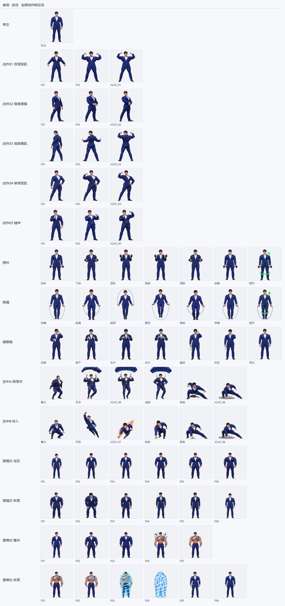

# Wu Feng — Desktop Pet for Windows

A transparent, always-on-top desktop companion that stands on your taskbar, works out, talks back,
and can be duplicated into a crowd of up to 20 clones.

Built from hand-made animation frames — no game engine, no web view, no GPU. The window is a native
Win32 **layered window** with true per-pixel alpha: only the character is clickable, everything else
passes straight through to your desktop.



---

## Download & Run

1. Click **Code → Download ZIP** on this page (or `git clone` the repo).
2. Extract the archive anywhere — it is fully portable, no installation.
3. Double-click **`桌宠01_武峰.exe`**.

**Requirements:** Windows 10 / 11 (64-bit). Nothing else — Python and all dependencies are bundled.

> **First launch may show "Windows protected your PC"** → click **More info → Run anyway**.
> The build is unsigned (no code-signing certificate), which is normal for hobby projects.
> Some antivirus engines flag every PyInstaller binary; add an exclusion if needed.

> **Keep the `_internal` folder next to the exe.** It contains the runtime and all animation frames.

---

## ✨ Features

| | |
|---|---|
| **8 animation sequences** | 5 posing actions · dumbbell (5 looping sets) · jump rope (5 looping sets) · glasses cleaning |
| **234 unique lines** | 20–24 per action, with a "last 10 lines" anti-repeat window |
| **3 interchangeable forms** | Normal · Passion (2-minute timer) · Inner mode (daily timer) |
| **Clone system** | Up to 20 pets, 10 s autonomy, clones mirror the main pet's actions and forms |
| **Drag & throw** | Lift him, release — 50 % parachute descent, 50 % rocket dive, both end in a ground slam |
| **Click-through** | Only opaque pixels capture the mouse |
| **Idle behaviour** | Acts on his own after ~90 s of silence |

---

## 🎮 Controls

| Input | What happens |
|---|---|
| **Click** | Plays a random action with a line of dialogue |
| **Drag** | Lifts him up — he crouches and protests |
| **Release in mid-air** | Parachute or rocket dive → ground slam → back to normal |
| **Right-click** | Menu, positioned beside him (never covering him) |
| **Esc** | Quit |
| **Space** | Says a random line |

---

## 🧭 Right-click menu

**Actions**
`Flex biceps` · `Chest-out pose` · `Turn & show back` · `Single-arm flex` · `"Shh — quiet"`
`Dumbbell sets` · `Jump rope` · `Clean glasses`

**Forms** (mutually exclusive)

| Form | Behaviour |
|---|---|
| **Passion form** | Grows ~18 % over 6 frames, then runs a **2-minute countdown** drawn on the body (`token 1:59`). Reverts automatically at zero. Actions are locked; clicking only yields token jokes. |
| **Inner mode** | Rips the suit over 5 frames (tattoo revealed) and shows a live **`holdings h:mm:ss`** counter of today's companionship time, updated every second. Actions are locked; clicking yields stock-market jokes. |
| **Back to normal** | 6-frame revert (inner mode restores the suit behind a light cocoon — no tired animation). |

**Clones**

| Item | Behaviour |
|---|---|
| `Create clone (n/20)` | Adds an autonomous copy — 20 pets maximum |
| `Close all clones (n)` | Removes every clone at once |

Each clone acts on its own every **10 s**, and **all clones act whenever the main pet acts**.
Clones can be dragged (they stay where you drop them) and closed individually via their own
right-click menu. They never speak. Entering Passion / Inner form transforms **every clone** too.
A small blue triangle hovers above the original so you can tell which one is "real".

**Misc**
`Mute (🤫)` · `Unmute` · `Air show` · `Always on top` · `Size: S / M / L / XL` · `Quit`

---

## 📊 Data

Today's companionship time (shown as "holdings" in Inner mode) is stored in:

```
%USERPROFILE%\.pet01_wufeng.json
```

Delete that file to reset the counter. The program never connects to the network.

---

## ❓ Troubleshooting

| Problem | Fix |
|---|---|
| Nothing happens on double-click | Make sure `_internal` sits next to the exe; check that the process `桌宠01_武峰` isn't already running (single instance only) |
| Hidden behind other windows | Right-click → **Always on top** |
| Clicks seem to pass through him | Only the character's opaque pixels are clickable — aim at the body |
| Sound stays muted | Right-click → **Unmute** |
| Too many clones | Right-click the original → **Close all clones** |
| Windows blocks the exe | **More info → Run anyway**; add an antivirus exclusion |

---

## 📄 License

- **Application and artwork**: © the author, all rights reserved.
- **Bundled third-party components** (Python runtime, Pillow, Tcl/Tk): their respective licenses.

The character images are a personal likeness — please don't reuse them in your own projects
without permission.
